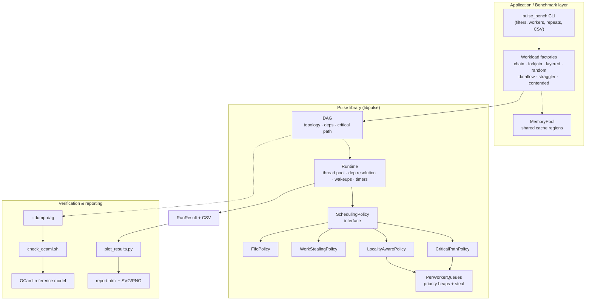
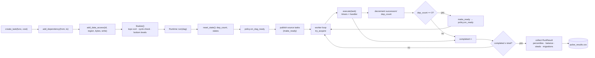
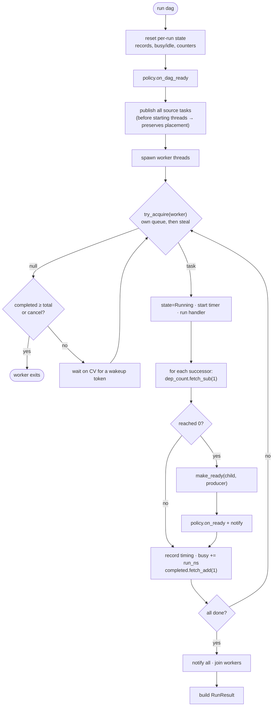
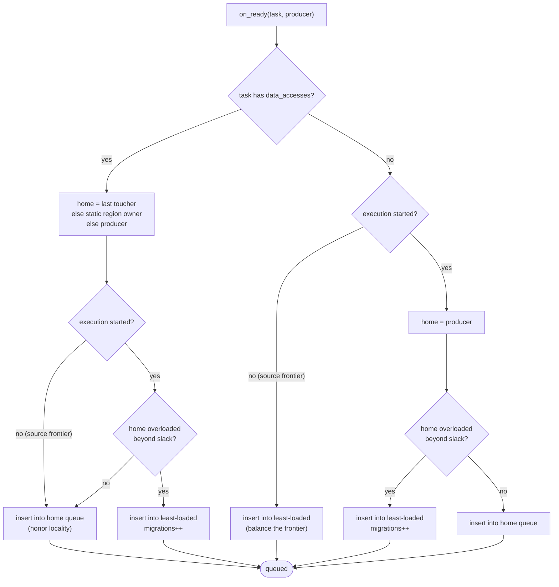
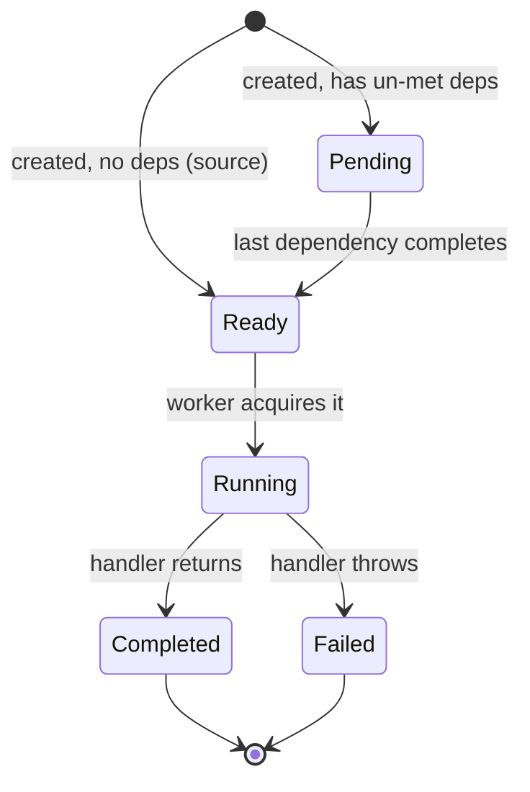
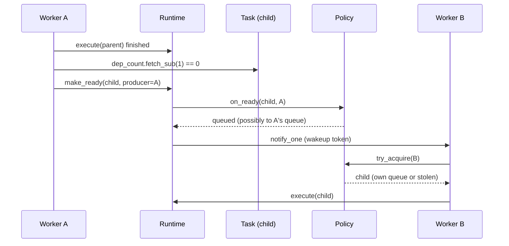
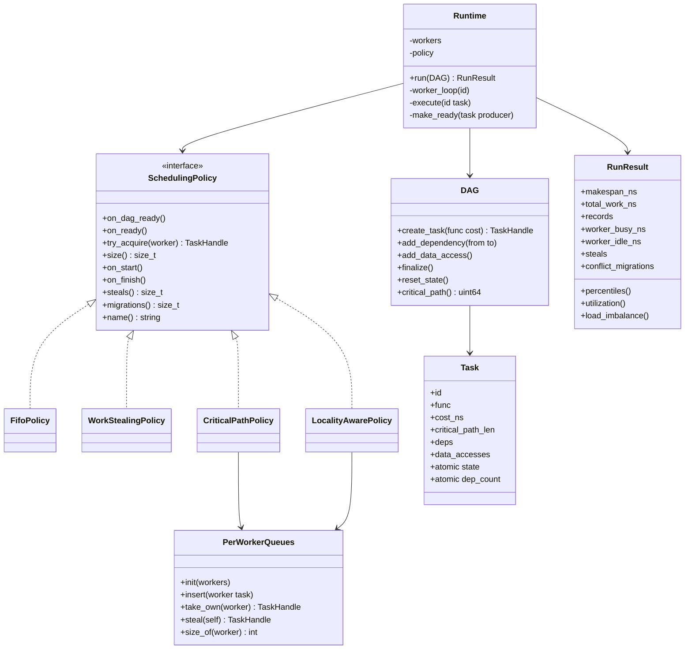
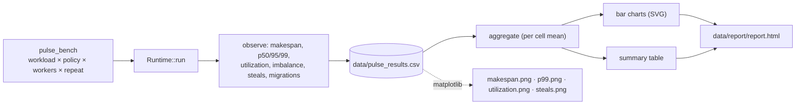
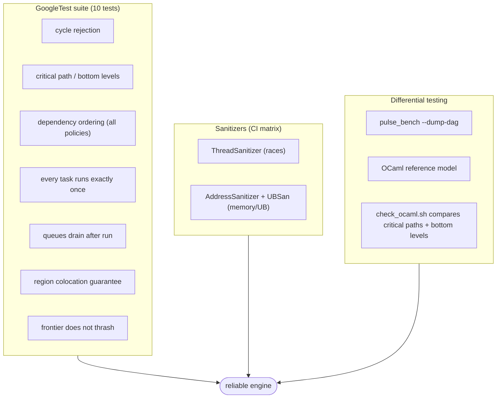

# Pulse — Project Overview, Design & Engineering Dossier

*A cache-aware, tail-latency-optimized parallel task scheduler.*

This single document explains **what Pulse is, what problem it solves, how it
differs from existing schedulers, what is innovative about it, every feature and
its purpose, and how it is designed** — with dataflow, flowchart, state,
sequence, and architecture diagrams.

---

## Table of contents

1. [Overview](#1-overview)
2. [The problem it solves](#2-the-problem-it-solves)
3. [Existing solutions and how Pulse differs](#3-existing-solutions-and-how-pulse-differs)
4. [Innovation and differentiators](#4-innovation-and-differentiators)
5. [Features and their purpose](#5-features-and-their-purpose)
6. [Software design](#6-software-design)
   - 6.1 [System architecture](#61-system-architecture)
   - 6.2 [Component responsibilities](#62-component-responsibilities)
   - 6.3 [Dataflow diagram](#63-dataflow-diagram)
   - 6.4 [Runtime execution flowchart](#64-runtime-execution-flowchart)
   - 6.5 [Scheduler decision flowchart (locality-aware)](#65-scheduler-decision-flowchart-locality-aware)
   - 6.6 [Task state machine](#66-task-state-machine)
   - 6.7 [Dependency resolution sequence](#67-dependency-resolution-sequence)
   - 6.8 [Module / type relationships](#68-module--type-relationships)
   - 6.9 [Benchmark & reporting pipeline](#69-benchmark--reporting-pipeline)
7. [Metric definitions](#7-metric-definitions)
8. [Measured results](#8-measured-results)
9. [Correctness & validation strategy](#9-correctness--validation-strategy)
10. [Build & run](#10-build--run)
11. [Repository layout](#11-repository-layout)

---

## 1. Overview

Pulse is a **parallel execution engine for directed acyclic graphs (DAGs) of
tasks**. You describe work as tasks with dependencies and optional data-access
metadata; Pulse runs that graph across a fixed pool of CPU core threads and
measures how four different scheduling strategies behave on the *same* work.

Its purpose is twofold:

- **A systems artifact** — a correct, race-free, benchmark-driven concurrent
  runtime with pluggable scheduling policies.
- **An experiment** — a controlled comparison of FIFO, work-stealing,
  critical-path, and a new *locality-aware adaptive* scheduler on identical
  workloads, with numbers rather than claims.

| Field | Value |
| --- | --- |
| Language (engine) | C++20 |
| Concurrency primitives | `std::thread`, `std::atomic`, `std::mutex`, `std::condition_variable` |
| Reference model | OCaml (standard library only) |
| Testing | GoogleTest, ThreadSanitizer, AddressSanitizer + UBSan |
| Benchmarking | Custom CSV driver (optional Google Benchmark), Linux `perf` |
| Reporting | Python + Matplotlib / dependency-free SVG |
| Build & CI | CMake, GitHub Actions |
| Scale tested | up to ~8,000 tasks, 1–16 workers, 7 workload shapes |

---

## 2. The problem it solves

Imagine 100,000 tasks. Some depend on others, some take microseconds and some
milliseconds, and some read or write the same data. A naive scheduler assigns
tasks in queue order or lets workers steal. That produces recognizable failure
modes:

| Symptom | Root cause |
| --- | --- |
| One core pegged, others idle | No load balancing across workers |
| A latency-sensitive task waits behind a long task | Arrival order ignores task priority / critical path |
| Good average throughput, terrible p99 | Priority/placement not aligned with dependencies |
| Cache lines bounce between cores | Same data touched on different cores (no locality) |
| Lock contention dominates | A single global ready queue |
| Nondeterministic, unreproducible results | No seedable workloads / replayable graphs |

**Question Pulse answers:** *given a DAG, how should ready work be distributed
across cores to maximize throughput, minimize tail latency, and reduce
synchronization and memory movement — without violating dependencies?*

Pulse attacks all five failure modes at once and quantifies the trade-offs:

- **Load balance** → distributed per-worker queues + stealing.
- **Critical path** → bottom-level (longest-path-to-sink) priority.
- **Data locality** → measured last-toucher region placement.
- **Tail latency vs. cache reuse** → an *adaptive* slack that migrates work only
  when the local worker is a genuine bottleneck.
- **Reproducibility** → seeded, rebuildable workloads and replayable graphs.

---

## 3. Existing solutions and how Pulse differs

Parallel task scheduling is a well-established field, and Pulse does **not**
claim to invent work-stealing or list scheduling. Its value is the *specific
combination* and the *rigorous, reproducible comparison* around one idea.

| Existing system / technique | What it does | How Pulse differs |
| --- | --- | --- |
| **Cilk / Cilk++** | Fork-join work-stealing with randomized victim selection | Pulse generalizes to arbitrary DAGs (not just fork-join) and both **measures** and **counts** steals; adds a data-locality dimension Cilk ignores |
| **Intel TBB** (`task_arena`, `parallel_for`, flow graph) | Mature, production work-stealing + task graph | Pulse is a transparent, benchmarkable *research harness* where each policy is a ~50-line file, not a black-box runtime |
| **OpenMP taskloop / depend** | Compiler-driven tasking | Pulse exposes the *scheduling decision itself* as an interface you can swap and A/B test |
| **Taskflow (C++), HPX, Rayon** | Modern task-graph libraries | Pulse is not a general library; it isolates scheduling policy effects under identical workloads and reports p50/p95/p99 + cache-oriented metrics |
| **Java ForkJoinPool, Go scheduler** | Production work-stealing | Pulse makes the *trade-off* explicit: fewer steals vs. better balance vs. locality, with measured migrations |
| **Graham list scheduling** | Prioritize by critical path to bound makespan | Pulse implements it distributed (`critical-path` policy) and then *extends* it with locality |
| **HEFT / DAG scheduling (HPC)** | Priority + placement, often heterogeneous | Pulse's contribution is the **adaptive** locality/balance override with an interpretable knob, validated on shared-memory cores |
| **PaRSEC / StarPU / Legion** | Locality-aware runtime task schedulers at scale | Pulse is deliberately single-node, small, auditable, and reproducible — a *lens* on the core trade-offs rather than a distributed runtime |
| **Sparrow (datacenter)** | Locality-aware placement via sampling | Pulse applies the idea at the CPU-cache level, with **measured** (not sampled) last-toucher tracking |

**In one sentence:** existing systems give you *a* scheduler; Pulse gives you a
*controlled laboratory* with four interchangeable schedulers, a correct shared
engine, sanitizer-clean concurrency, an independent OCaml oracle, and a
reproducible benchmark pipeline focused on the locality-vs-latency trade-off.

---

## 4. Innovation and differentiators

### 4.1 The core idea — an adaptive locality/balance override

Most locality-aware schedulers either (a) pin work to a core and accept load
imbalance, or (b) balance freely and lose cache reuse. Pulse makes the trade-off
a **first-class, adaptive decision**:

- Each data region has a **measured "last toucher"** core (updated as tasks
  finish), not just a static assignment.
- A newly-ready task is sent to its locality home **unless** that home's live
  load (queued + running) exceeds the least-loaded core by more than a `slack`.
- `slack` is **derived from the workload**: the fraction of tasks that declare
  data sharing scales it from 1 (no data → strictly balance) to 6 (fully
  data-sharing → keep more cache reuse).
- Every override is counted as a **migration**, so the trade-off is observable
  in the benchmark output rather than hidden.

### 4.2 The innovation that makes it actually work — the frontier guard

A subtle but critical finding, locked in by tests: the *entire* benefit
evaporates if the override fires while the **source frontier** is being
published, because at that moment queue depth reflects enqueue order, not real
load. Without a guard, the policy scattered every region across all cores
(4.00 cores/region). With execution-gated activation, it reaches **1.08
cores/region** with zero migrations on the source-only workload.

This is the project's most defensible contribution: a mechanism plus the
understanding of *when not to use it*.

### 4.3 Secondary differentiators

| Differentiator | Why it matters |
| --- | --- |
| **One correct engine, four policies** | Policies differ only in the dispatch decision, so comparisons are apples-to-apples |
| **Differential oracle in OCaml** | An independent, auditable model cross-checks critical paths and bottom levels against C++ |
| **Sanitizer-clean concurrency** | TSan/ASan prove the concurrently-written counters and queues are race-free (two real races were found and fixed) |
| **Reproducible benchmarks** | Seeded workload factories + replayable DAGs; mean over repeats written to CSV |
| **Honest reporting of losses** | The docs state where the policy does *not* win (no-data irregular graphs) |
| **No AI / no distributed sprawl** | Focused on the scheduler itself, per the project's original scope |

---

## 5. Features and their purpose

| # | Feature | Purpose |
| --- | --- | --- |
| F1 | **DAG model** (`create_task`, `add_dependency`, `add_data_access`) | Describe interdependent work and data sharing |
| F2 | **Cycle detection + topological sort** (`finalize`) | Reject invalid graphs; establish a legal execution order |
| F3 | **Bottom-level / critical-path computation** | Quantify each task's distance-to-sink; basis for priority scheduling |
| F4 | **Replayable runs** (`reset_state`) | Re-run a finalized graph cheaply and deterministically for benchmarks |
| F5 | **`SchedulingPolicy` interface** | Clean seam: policies own *ordering*, runtime owns *everything else* |
| F6 | **FIFO policy** | Simple, low-overhead reference point |
| F7 | **Work-stealing policy** | Per-worker deques; idle workers steal to balance load |
| F8 | **Critical-path policy** | Distributed priority heaps keyed by bottom level; shorter makespan |
| F9 | **Locality-aware adaptive policy** | The contribution: measured locality + adaptive load override |
| F10 | **Per-worker priority queues + stealing** (`PerWorkerQueues`) | Shared machinery so F8/F9 are measured against the same data structure |
| F11 | **Dependency resolution without a global lock** | Atomics decrement `dep_count`; only the runtime wakes dependents |
| F12 | **Counting-wakeup worker pool** | Wakes sleepers without losing wakeups or spinning hot |
| F13 | **Per-task timing + per-worker busy/idle instrumentation** | Enables latency percentiles and load-imbalance metrics |
| F14 | **MemoryPool + seeded workloads** | Realistic cache traffic and reproducible shapes |
| F15 | **Seven workload generators** | Exercise chain, fork-join, layered, random, dataflow, straggler, contended regimes |
| F16 | **CSV benchmark driver** | Machine-readable results for every (workload, policy, workers, repeat) |
| F17 | **HTML/SVG + optional PNG report** | Human-readable comparison charts and summary tables |
| F18 | **OCaml reference model + differential check** | Independent verification of graph analyses |
| F19 | **Sanitizer build option + CI matrix** | Prove and continuously guard concurrency correctness |
| F20 | **Unit tests** | Correctness, invariants, and robustness across all policies |

### Feature details worth calling out

- **F9 / F10 locality:** `fifo` gives up locality entirely; `critical-path` runs
  the heaviest-remaining task first; `locality-aware` reuses the same heaps but
  injects region-aware placement.
- **F11:** Each task holds an `atomic<int> dep_count`. When a task finishes it
  decrements each successor; whichever worker drops a counter to zero "owns"
  waking that child. No lock is taken to discover readiness.
- **F12:** A counting-semaphore of wakeups (`wakeups_`) plus a condition
  variable bounds spinning and prevents lost wakeups.
- **F14 / F15:** `build_contended` models **false sharing** correctly: each task
  writes a *distinct* element, but eight consecutive doubles share one cache
  line, so spreading a region across cores causes measurable ping-pong.

---

## 6. Software design

### 6.1 System architecture



### 6.2 Component responsibilities

| Component | Owns | Must NOT do |
| --- | --- | --- |
| `DAG` | Tasks, edges, reverse adjacency, cycle check, bottom levels | Run tasks |
| `Runtime` | Threads, dependency resolution, wakeups, timers, `RunResult` | Decide which ready task runs |
| `SchedulingPolicy` | The dispatch decision (`on_ready`, `try_acquire`) | Create threads or resolve dependencies |
| `PerWorkerQueues` | Per-worker max-heaps + stealing + depth counters | Choose *where* a task goes |
| `MemoryPool` | Shared regions that generate cache traffic | Schedule |
| Workloads | Build seeded DAGs | Execute |
| `pulse_bench` | Drive the matrix, write CSV, print summary | Schedule |
| `plot_results.py` | Aggregate CSV, render report | Benchmark |

This separation is deliberate: **the policy is the only thing that changes
between experiments**, which makes the comparison scientifically meaningful.

### 6.3 Dataflow diagram

How a task travels from declaration to completion and measurement:



### 6.4 Runtime execution flowchart



### 6.5 Scheduler decision flowchart (locality-aware)

This is the heart of the experimental contribution:



`slack = 1 + round(5 × share_of_tasks_with_data)`, so it adapts to the workload
between 1 (pure balance) and 6 (favor cache reuse).

### 6.6 Task state machine



### 6.7 Dependency resolution sequence



### 6.8 Module / type relationships



### 6.9 Benchmark & reporting pipeline



---

## 7. Metric definitions

| Metric | Definition | Better |
| --- | --- | --- |
| Makespan | Wall time from first task start to last task end | lower |
| Throughput | `tasks / makespan` | higher |
| Speedup | `total_work / makespan` (≈ effective cores used) | higher |
| Utilization | `total_work / (makespan × workers)` | higher (1.0 = all cores busy) |
| Load imbalance | std-dev of per-worker busy time ÷ mean | lower |
| p50 / p95 / p99 latency | Per-task `end − ready` percentiles | lower |
| p99 wait | Per-task `start − ready` at p99 | lower |
| Steals | Successful cross-worker acquisitions | context-dependent |
| Migrations | Tasks dispatched away from their locality home to balance load | lower = more locality kept |

---

## 8. Measured results

Representative means at **8 workers** from `data/pulse_results.csv`
(lower makespan better; fewer steals = less queue contention):

| workload | policy | makespan (ms) | steals | migrations |
| --- | --- | ---: | ---: | ---: |
| contended | fifo | 2.474 | 0 | 0 |
| contended | work-stealing | 2.460 | 5255 | 0 |
| contended | critical-path | 6.025 | 5355 | 0 |
| **contended** | **locality-aware** | **1.983** | **340** | 0 |
| dataflow-8k | work-stealing | 4.884 | 267 | 0 |
| dataflow-8k | critical-path | 5.031 | 488 | 0 |
| dataflow-8k | locality-aware | 5.345 | **59** | 12 |
| straggler | work-stealing | **26.043** | 4004 | 0 |
| straggler | critical-path | **26.034** | 3481 | 0 |
| straggler | locality-aware | 26.408 | **36** | 28 |

**Cache-locality measurement** on the contended workload (distinct cores touching
each data region):

| policy | mean cores / region |
| --- | ---: |
| fifo | 4.00 |
| critical-path | 4.00 |
| work-stealing | 2.52 |
| **locality-aware** | **1.08** (98% of a region's tasks on one core) |

### Where Pulse's policy does **not** win

- **No-data irregular graphs** (`random-5k-3`): makespan is essentially equal
  across policies (utilization-bound). Priority-based policies shorten the
  makespan but raise task p99 latency (high-priority work jumps the queue).
  This is a real tail-latency trade-off, documented rather than hidden.
- **Sequential graphs** (`chain-1k`): no exploitable parallelism; nothing beats
  the critical path.

---

## 9. Correctness & validation strategy



- **TSan found and we fixed two real data races:** a shared `mt19937_64` on the
  work-stealing path, and overlapping writes in the synthetic contention
  workload (replaced with a race-free false-sharing model).
- The **OCaml model** independently recomputes topological validity, total
  critical path, per-task bottom levels, and simulates ideal FIFO/critical-path
  list schedules.

---

## 10. Build & run

```bash
# Configure + build + test
cmake -S . -B build -DCMAKE_BUILD_TYPE=Release
cmake --build build -j
(cd build && ctest --output-on-failure)

# Sanitizer builds (also run in CI)
cmake -S . -B build-tsan -DCMAKE_BUILD_TYPE=Debug -DPULSE_SANITIZE=thread
cmake --build build-tsan -j && (cd build-tsan && ctest)
# PULSE_SANITIZE ∈ {address, thread, undefined}

# Full benchmark matrix (worker counts 1..16) + report
./scripts/run_benchmarks.sh

# One cell, or dump a DAG for the OCaml oracle
./build/benchmarks/pulse_bench --workload dataflow-8k --policy all --workers 8 --repeats 5
./build/benchmarks/pulse_bench --dump-dag random-5k-3

# Independent verification
./scripts/check_ocaml.sh

# Render the report
python3 scripts/plot_results.py data/pulse_results.csv --out data/report
```

---

## 11. Repository layout

```
Pulse/
├── CMakeLists.txt              Top-level build, sanitizer option
├── README.md                   Short project README
├── PROJECT.md                  This document (overview + design dossier)
├── include/pulse/
│   ├── task.hpp                Task, TaskHandle, DataAccess, atomics
│   ├── dag.hpp                 DAG construction & analysis
│   ├── policy.hpp              SchedulingPolicy interface
│   ├── per_worker_queues.hpp   Priority heaps + work-stealing machinery
│   ├── runtime.hpp             Worker pool, dependency resolution, timings
│   ├── workload.hpp            MemoryPool + workload factories
│   └── stats.hpp               RunResult + percentile/balance statistics
├── src/
│   ├── dag.cpp                 Topo sort, cycle check, critical paths
│   ├── runtime.cpp             Thread pool, wakeups, instrumentation
│   ├── workload.cpp            Seeded generators + memory pool
│   ├── policy_fifo.cpp
│   ├── policy_work_stealing.cpp
│   ├── policy_critical_path.cpp
│   └── policy_locality_aware.cpp   ← the experimental contribution
├── tests/test_basic.cpp        GoogleTest suite
├── benchmarks/pulse_bench.cpp  CSV benchmark driver
├── ocaml/pulse_ref.ml          Independent reference model
├── scripts/
│   ├── run_benchmarks.sh       Full matrix + report
│   ├── check_ocaml.sh          Differential test vs OCaml
│   └── plot_results.py         HTML/SVG/PNG reporting
├── data/                       Generated CSV + report
└── .github/workflows/ci.yml    Build, test, sanitizer matrix, report
```
